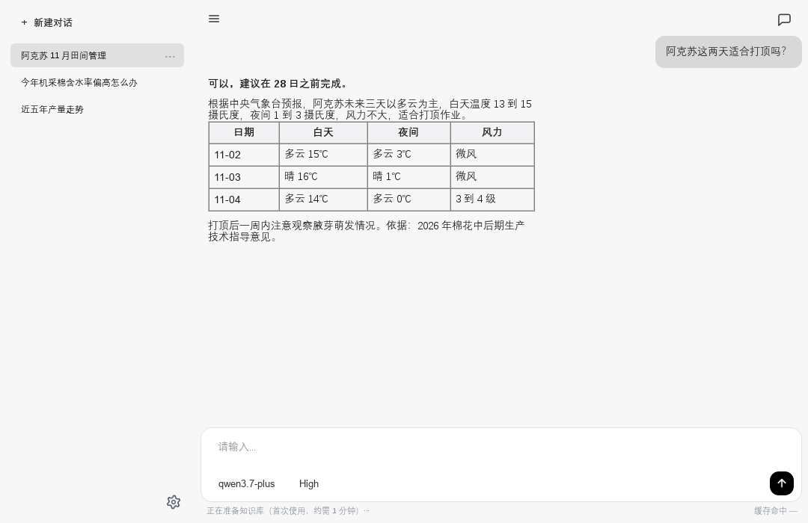
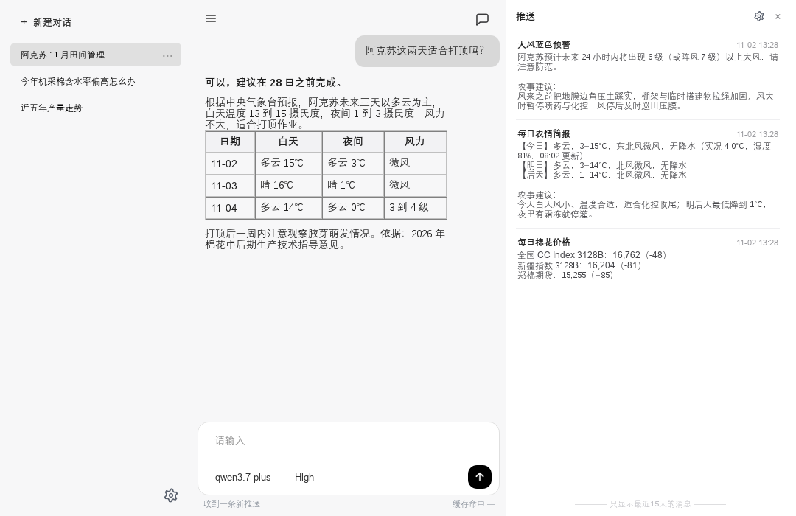

# 棉花种植决策智能体（CottonMind）

**一个会自己去查资料的种植助手。**

你问今天能不能打顶，它不会先给你一段听起来很顺的话。它去看天气，翻本地那几百页农技资料，然后告诉你：能，但要赶在后天降温之前，夜里会掉到 1℃。哪句话出自哪份文件，写在后面。



## 它相信的事

农事判断慢一点没关系，错一次的代价太大。所以这个项目里大部分功夫不花在"让回答更漂亮"，而花在"让每个数字都有出处"。

天气与价格只从接口取，模型不许自己报数。工具按白名单调用，没写进能力的工具按最严格的方式对待。检索到的段落带着文件名与年份，同一个主题存了多个年份时只取最新那版。带区间的估计由代码决定能说到什么程度，模型不能把"估计"讲成"确定"。

这几条听起来像限制，其实是它和通用大模型最大的区别。

## 它做什么

**回答问题。** 文档导入后切分、向量化，检索时先召回一批候选，再精排取最相关的几段，交给模型组织语言。改动一篇文档只重新处理那一篇。

**记住事情。** 对话分四层管理：当前上下文、近期对话、长期摘要、实体记忆。近期对话超长时自动摘要，摘要可以按语义找回，实体记忆按作物画像与项目事实分开存。成功的操作路线单独记一份，下次遇到同类问题直接复用。

**调用工具。** 八个，覆盖天气、官方预警、联网搜索、当日棉价、产量与面积、价格波动、趋势绘图、产量预测。桌面端与 MCP 服务端共用同一套实现。

**跑长流程。** 流程写成 YAML，可以并行、可以断点续跑、可以等人工确认。运行前做静态校验，环与孤立节点不用跑起来也能查出来。

**自己开口。** 每天清晨把当天与未来两天的天气、以及该干什么推到面前。气象台发布预警时说明影响与应对，等级升了会重新提醒，同一条信号不反复打扰。收盘后给一份棉花价格。消息进抽屉，不进对话，换会话也不会丢。



**换服务商。** 对话模型与向量化服务都能替换，任意兼容 OpenAI 协议的端点都可以加。联网搜索可以在 Tavily 与 DeepSeek 之间切换。

## 它不做什么

不做通用助手。知识库与农事口径只覆盖新疆棉花一个作物一个区域，换别的作物得重新整理资料、改提示词。

不做图像识别。感知层只有框架和命令行入口，没有接真实数据，暂时不该拿它做生产判断。

不假装预警接口是稳定的。气象台那个接口是网页背后的接口，不是正式开放 API，改版就会失败。失败时它说失败，不拿昨天的数据充今天。

不替气象台发布预警。等级与量级一律引用官方原文，程序只做筛选和翻译，不做判断。

## 把它跑起来

需要一个对话模型密钥和一个向量化服务密钥，Python 3.11 以上。

```bash
pip install -r requirements.txt
cp .env.example .env      # 填入 DEEPSEEK_API_KEY 与 EMBEDDING_API_KEY
python build_kb.py        # 首次建库，需要几分钟
python main.py
```

知识库没建好时，问答与简报都会提示"知识库未就绪"，等它跑完即可。想换成别的服务商，在设置里加卡片，不用改文件。

```bash
python mcp_server.py             # 以 MCP 服务端暴露工具
python tools/kb_admin.py sync    # 文档有更新时增量同步
python build_release.py          # 打发布包
```

`add` 会把文件放到 `data/` 根目录，破坏按主题分的结构。想保留分类，把文件放进对应子目录再 `sync`。其余配置项见 `.env.example` 与设置窗口。

## 每天它自己做的事

三条推送，节奏按钟点走：简报每天 08:00，预警在 06、12、18、00 点各查一次，价格每天 17:00。设置里可以改地区、单独关掉某一条，也可以当场运行一次看看效果。

预警的正文分两段。前一段是等级与未来几小时的量级，由代码按官方原文拼好，模型碰不到；后一段是农事建议，由模型写。分开写是因为让模型碰这些数字，它有机会把蓝色写成较强，顺手再补一个量级。

## 项目结构

```
cotton_agent/
├── main.py                  桌面端入口
├── mcp_server.py            MCP 服务端
├── build_kb.py              知识库构建
├── build_release.py         发布构建
├── core/
│   ├── rag_engine.py        问答引擎
│   ├── knowledge_base.py    向量库与检索
│   ├── schedule.py          定时触发
│   ├── alarms.py            气象预警
│   ├── weather.py           天气数据源
│   ├── notifications.py     通知存储
│   ├── orchestration/       工作流引擎
│   ├── perception/          感知层
│   └── tools/               工具实现与契约
├── ui/                      PyQt6 界面
├── workflows/               工作流定义
├── prompts/                 提示词
├── skills/                  手写技能
└── data/                    知识库文档源
```

## 开发

守卫 45 个，覆盖架构约束、工具契约、编排语义、数据源与界面行为，全部离线可跑，失败即非零退出。评测脚本 11 个，用固定数据集量检索质量、工具选择准确率与生成质量。

```bash
python tests/check_schedule.py    # 单个守卫，自带通过数与失败明细
python tests/run_all.py           # 跑评测，产出 eval_report.md
```

改代码只有一条硬规矩：新增工具要同时更新契约、实现与能力声明三处。漏一处的失败方向是更严，不会静默通过。新增或修改功能请顺手补守卫。

慢在哪、错在哪，可以打开埋点看。默认关闭，打开后每次问答与每条推送的每一步都会记到本地，不联网：

```bash
# PowerShell：先设环境变量再启动
$env:OBSERVABILITY_ENABLED = "1"
python main.py

# 查看
python tools/traces.py list            # 最近若干条
python tools/traces.py show <trace_id> # 一条链路的时间线
python tools/traces.py slow            # 最慢的步骤，按名字归类
```

只记模型名、token 数、耗时与成败，正文需要另开开关才会记录。

截图由 `python tools/make_readme_shots.py` 离屏渲染，界面改了重跑一次即可。

## 限制

知识库里的技术指导来自公开渠道，其中几份文件名不含年份，程序判断不了时效，会照原文引用，请自行核对。

推送依赖气象台与棉价网站，这两个都不是正式开放接口。它们挂掉的时候，你会收到一条"取数失败"，而不是一条看起来正常的旧数据。

感知层与轨迹仍在框架阶段。凭据以明文存在本机，靠系统账户权限隔离。

## License

MIT