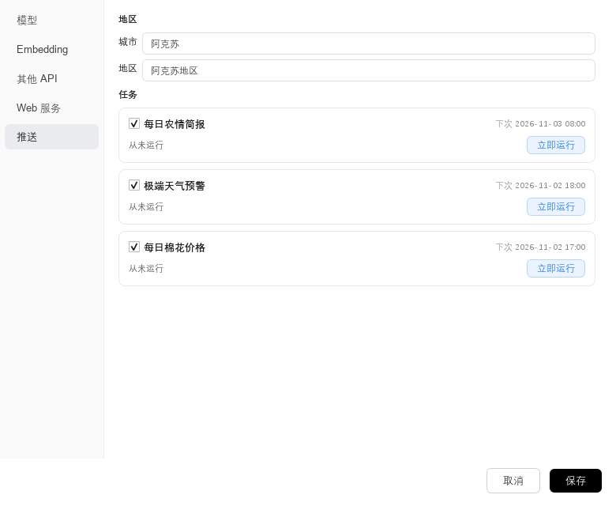
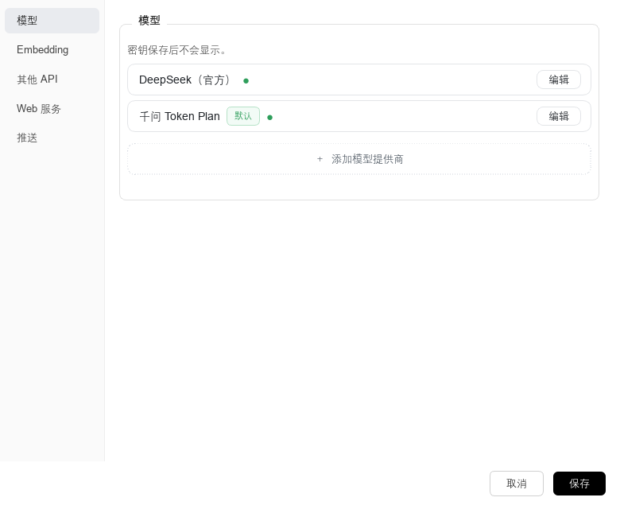

# 棉花种植决策智能体（CottonMind）

输入框里问一句"这两天适合打顶吗"，它会先去查当地天气、翻本地的农技资料，再给出带出处的答复，而不是凭语感编一段。除了被动回答，它每天还会主动推送农情简报，气象台发布预警时第一时间提醒，收盘后给出棉花价格。

当前版本 0.5.0，桌面端应用，Windows 下开箱可用。


## 为什么不是直接问大模型

通用大模型答得出"棉花什么时候打顶"，但答不了"阿克苏这块地这两天能不能打顶"。差别在四件事上：

**数字只能从数据来。** 天气、价格、产量都由工具取回，模型不能自己报一个温度。推送里的预警等级、未来几小时的量级，是代码按官方原文拼好的，模型只负责写建议部分。

**工具调用有白名单。** 每个工具声明自己能做什么（只读、还是可能写盘、要不要联网），没声明的按最严格处理。模型想调用一个不存在的工具，会拿到带候选的纠正提示，而不是静默失败。

**每条结论能对回原文。** 检索到的段落和最终回答都带文件名与年份，觉得不对可以翻原文。同一个主题存了多个年份的指导意见时，只取最新那版，不会把 2023 年的方案当成今年的。

**数值能不能用有闸门。** 产量预测这类带区间的估计，由代码判断区间是否跨阈值，再决定是给结论、给区间还是只给定性说法。模型不能自己把"估计"说成"确定"。

## 界面

主界面分三块。左侧是会话列表，中间是聊天区，右上角的图标是推送抽屉。聊天支持 Markdown、表格与图表，回答里会标注引用的文件名。

推送都进抽屉，不进对话，换会话也不会丢：


推送的时间与开关都在设置里改，也可以当场运行一次看效果：



模型与向量化服务都按卡片管理，可以添加任意兼容 OpenAI 协议的服务商：



## 功能特性

**资料问答**

导入的农技文档会被切分、向量化并存入本地知识库。检索时先用向量召回一批候选段落，再用精排模型重新排序，最后交给大模型组织答案。知识库支持增量同步，改动一篇文档只重新处理这一篇。

**分层记忆**

对话上下文分四层管理，逐级压缩并持久化保存。第一层是实时组装的上下文，第二层是近期对话，超过长度阈值时自动摘要；第三层是长期摘要，可以按语义检索历史情节；第四层是实体记忆，按作用域分成作物画像与项目事实两个库。另有一个技能库，记录成功的操作路线，下次遇到同类问题可以直接复用。

**工具调用**

内置八个工具，覆盖天气查询、官方气象预警、联网搜索、当日棉花价格、产量与面积统计、价格波动分析、趋势绘图和产量预测。工具由模型自主选择，桌面端与 MCP 服务端共用同一套实现。

**工作流编排**

长流程可以写成 YAML，支持并行节点、断点续跑、节点级重试和失败策略，运行前做静态校验。需要人工确认的环节可以暂停等待，恢复后不会重复执行已完成的节点。

**主动推送**

每天 08:00 推送当天与未来两天的天气和田间建议。气象台发布预警时，说明影响与应对，等级升级会重新提醒，同一条信号不会反复打扰。每天 17:00 推送全国指数、疆内指数与郑棉期货。三类消息都可以单独关闭。

**多服务商接入**

对话模型与向量化服务都可以替换。联网搜索可以在 Tavily 与 DeepSeek 之间切换，两个服务各有开关。凭据保存在本地文件里，界面上只能看到是否已配置。

## 快速开始

需要 Python 3.11 或更高版本，以及一个对话模型密钥与一个向量化服务密钥。

```bash
# 1. 安装依赖（必需）
pip install -r requirements.txt

# 2. 准备配置（必需）
#    复制 .env.example 为 .env，填入 DEEPSEEK_API_KEY 与 EMBEDDING_API_KEY
#    也可以在启动后通过设置窗口填写

# 3. 构建知识库（必需，首次需要几分钟）
python build_kb.py

# 4. 启动桌面端（必需）
python main.py
```

以下两步按需使用：

```bash
python mcp_server.py       # 以 MCP 服务端形式暴露工具，供其他客户端调用
python tools/kb_admin.py sync   # 文档有更新时做增量同步（启动时也会自动检测）
```

首次启动会加载向量模型并检查知识库指纹，状态栏会显示进度。知识库没建好时，问答和简报都会提示"知识库未就绪"，等它跑完即可。

## 配置项

| 配置项 | 说明 |
|---|---|
| `DEEPSEEK_API_KEY` | 对话模型密钥，必填 |
| `EMBEDDING_API_KEY` | 向量化服务密钥，构建知识库必需 |
| `EMBEDDING_BASE_URL` | 向量化服务地址，默认使用硅基流动 |
| `EMBEDDING_MODEL` | 向量模型，默认 `BAAI/bge-large-zh-v1.5` |
| `LLM_PROVIDER` | 默认对话服务商，取值见 `core/providers.py` |
| `LLM_MODEL` | 默认模型名称 |
| `EMBEDDING_PROVIDER` | 默认向量化服务商，留空时沿用上面三个 `EMBEDDING_` 开头的配置 |
| `RERANK_BASE_URL` | 精排服务地址，留空时继承向量化服务 |
| `RERANK_API_KEY` | 精排服务密钥，留空时继承向量化服务 |
| `AMAP_API_KEY` | 高德地图密钥，用于地名解析与天气兜底 |
| `TAVILY_API_KEY` | Tavily 搜索密钥 |
| `WEATHER_SOURCE` | 天气数据源，可选 `auto`、`nmc`、`amap` |
| `WEB_SEARCH_BACKEND` | 搜索优先级，可选 Tavily 或 DeepSeek |
| `WEB_SEARCH_TAVILY_ON` | Tavily 搜索开关 |
| `WEB_SEARCH_DEEPSEEK_ON` | DeepSeek 搜索开关 |
| `DEEPSEEK_SEARCH_API_KEY` | DeepSeek 搜索专用密钥，留空时沿用对话模型密钥 |
| `SHIPPED_SKILL_DIR` | 手写技能目录，默认为 `skills` |
| `EXTERNAL_SKILL_DIRS` | 外部技能目录，多个目录用分号分隔 |
| `TRAJECTORY_PATH` | 轨迹录制输出路径，留空表示关闭 |

凭据以明文保存在本机 `%APPDATA%\CottonAgent` 目录下，靠操作系统的用户权限隔离，同一台机器上的其他账户无法读取。这是有意为之：桌面端加密没有实际意义，因为解密密钥必须和密文放在同一台机器上。

## 常用命令

| 命令 | 用途 |
|---|---|
| `python tools/kb_admin.py status` | 查看知识库与文档的差异 |
| `python tools/kb_admin.py sync` | 只重新处理有变化的文档 |
| `python tools/kb_admin.py add <文件>` | 加入新文档 |
| `python tools/kb_admin.py remove <文件>` | 移除文档 |
| `python tools/kb_admin.py list` | 查看已索引的文档 |
| `python tools/kb_admin.py rebuild` | 全量重建知识库 |
| `python build_release.py` | 构建发布包 |
| `python tests/run_all.py` | 运行评测并生成报告 |

`add` 会把文件放到 `data/` 根目录，破坏按主题分的目录结构。希望保留分类时，把文件放进 `data/` 下对应的子目录，再执行 `sync`。

## 项目结构

```
cotton_agent/
├── main.py                   桌面端入口
├── mcp_server.py             MCP 服务端（stdio）
├── bootstrap.py              启动引导：数据目录探测与环境加载
├── config.py                 全局配置
├── paths.py                  构建产物路径
├── build_kb.py               知识库构建
├── build_exe.py              开发构建
├── build_release.py          发布构建
├── updater_runner.py         自动更新安装器
├── core/
│   ├── rag_engine.py         问答引擎
│   ├── knowledge_base.py     向量库与检索
│   ├── kb_builder.py         文档同步与重建
│   ├── user_memory.py        长期记忆读写
│   ├── procedural_memory.py  技能结晶档
│   ├── skill_loader.py       手写技能加载
│   ├── query_router.py       分级网关
│   ├── uncertainty.py        不确定性门控
│   ├── context_budget.py     上下文预算
│   ├── prompt_layers.py      提示分层
│   ├── providers.py          对话服务商登记表
│   ├── embedding_providers.py 向量化服务商登记表
│   ├── credentials.py        凭据读写
│   ├── model_cache.py        模型清单缓存
│   ├── schedule.py           定时触发
│   ├── alarms.py             气象预警抓取与解析
│   ├── weather.py            天气数据源
│   ├── notifications.py      通知存储
│   ├── orchestration/        工作流引擎
│   ├── perception/           感知层
│   └── tools/                工具实现与契约
├── ui/                       PyQt6 界面
├── workflows/                工作流定义
├── prompts/                  提示词
├── skills/                   手写技能
├── data/                     知识库文档源
├── assets/readme/            README 用的截图
├── tools/                    维护脚本
├── tests/                    回归守卫与评测
└── requirements.txt
```

## 开发与测试

回归守卫共 45 个，覆盖架构约束、工具契约、编排语义、数据源与界面行为，全部可以离线运行，失败时非零退出，可以直接接进 CI。另有 11 个评测脚本，用固定数据集衡量检索质量、工具选择准确率、生成质量与记忆治理效果。

```bash
# 逐个跑守卫（每个脚本自带通过数与失败明细）
python tests/check_schedule.py

# 跑评测，产出 eval_report.md
python tests/run_all.py
```

打包使用 PyInstaller：

```bash
python build_release.py
```

产物存放在 `release/` 目录。构建脚本会剔除运行期残留文件，检查是否误打包了密钥，然后压缩成发布包。截图由 `python tools/make_readme_shots.py` 离屏渲染生成。

## 已知限制

知识库里的技术指导文件来自公开渠道，其中一部分文件名不含年份，程序无法判断它们的时效，回答时会照原文引用，请自行核对。

气象预警与天气数据来自中央气象台网页背后的接口，不是正式开放的 API，接口变动会导致取数失败。这时程序会如实报告失败，不会用旧数据冒充当天情况。

感知层目前只有框架和命令行入口，尚未接入正式数据，暂不建议用于生产判断。

当前只针对新疆棉花这一个作物与区域做了知识库和农事口径，换其他作物需要重新整理资料并改写提示词。

## Roadmap

近期计划把感知层接到真实抽样数据上，并补上预警源不可用时的降级路径。中期希望把知识库的年份时效从文件名推断改成文档内元数据，减少对命名规范的依赖。更远的事包括支持第二个作物，以及把安装包体积从两百兆降下来。

## 参与贡献

欢迎提 issue 与 pull request。提交前请确认三件事：新增或修改的功能有对应的守卫，`python tests/run_all.py` 能跑通，代码里的中文注释说明"为什么这么做"而不是"做了什么"。新增工具需要同时更新契约、实现与能力声明三处，漏一处的失败方向是更严，不会静默通过。

## 常见问题

**没有独立显卡能跑吗。** 可以。向量化走的是云端接口，本地只做检索与界面渲染。

**知识库要建多久。** 首次导入几十篇文档通常在几分钟内完成，主要时间花在调用向量化接口上。之后启动只做增量比对，很快。

**能不能换成别的模型。** 可以。设置里能添加任意兼容 OpenAI 协议的服务商，对话模型与向量化服务分开配置。

**为什么有时候收不到预警。** 预警只在气象台对所在地区发布了信号时才推。当地没有生效预警时，手动运行会明确告诉你"当前没有生效的气象预警"，不会编一条。

**数据和记忆存在哪里。** 全部在本机 `%APPDATA%\CottonAgent` 目录下，包括知识库、对话、记忆与推送记录。换机器时不带过去。

## 版本与更新

当前版本 0.5.0，对应 tag `v0.5.0`。每个版本的改动记录在仓库的 Releases 页面，也可以在命令行查看：

```bash
git tag --list
git show v0.5.0 --stat
```

## License

MIT